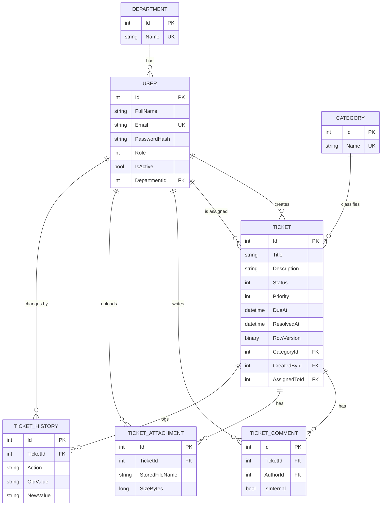

# IT Service Desk & Ticket Management System

Capstone project (title #2) for the **.NET Full Stack** track: employees raise IT support tickets, agents work them
against SLA deadlines, and admins manage users, categories and reports.

**Stack:** ASP.NET Core 8 Web API · C# · EF Core + LINQ · SQL Server · JWT auth · Serilog · xUnit + Moq ·
Angular 17 (standalone) + TypeScript + Bootstrap 5 · Docker · GitHub Actions

---

## 1. Run it

### Option A – Docker (SQL Server + API + UI in one command)
```bash
cp .env.example .env        # edit SA_PASSWORD and JWT_KEY
docker compose up --build
```
UI: http://localhost:8080 · Swagger: http://localhost:5080/swagger

### Option B – local development
Prerequisites: .NET 8 SDK, Node 20+, SQL Server LocalDB or any SQL Server.

```bash
# 1) API  (creates the database and seeds demo data on first start)
cd backend/ServiceDesk.Api
dotnet run                     # http://localhost:5080/swagger   (Development uses a dev-only JWT key)

# 2) UI
cd frontend
npm install
npm start                      # http://localhost:4200  (proxy.conf.json forwards /api to :5080)
```
Using a different SQL Server? Change `ConnectionStrings:DefaultConnection` in `appsettings.json`
(or use `dotnet user-secrets`).

### Demo accounts (seeded)
| Role  | Email                    | Password   |
|-------|--------------------------|------------|
| Admin | admin@servicedesk.local  | Admin@123  |
| Agent | agent@servicedesk.local  | Agent@123  |
| User  | user@servicedesk.local   | User@1234  |

> Set `Database:SeedDemoData` to `false` in production so these accounts are not created.

### Tests
```bash
dotnet test backend/ServiceDesk.sln --collect:"XPlat Code Coverage"   # xUnit + Moq, EF Core InMemory
cd frontend && npx ng test --watch=false --browsers=ChromeHeadless    # Jasmine/Karma
```

### Migrations (instead of EnsureCreated)
The API calls `EnsureCreated()` so it runs with zero setup. To switch to proper migrations:
```bash
dotnet tool install --global dotnet-ef
cd backend/ServiceDesk.Api
dotnet ef migrations add InitialCreate
```
then replace `EnsureCreatedAsync()` in `Program.cs` with `MigrateAsync()`.

---

## 2. Features

| Area | What it does |
|------|--------------|
| Auth | Register, login, JWT (60 min), BCrypt-style salted hashing via ASP.NET Core `PasswordHasher`, rate-limited auth endpoints |
| Roles | **User** (own tickets), **Agent** (all tickets, assign, internal notes, dashboard, Excel), **Admin** (everything + users, categories, delete) |
| Tickets | Full CRUD, status workflow, priority-based SLA due date, overdue flag, audit history, optimistic concurrency (`RowVersion`) |
| Search / sort / filter | Text search, status, priority, category, overdue; sortable columns; paging |
| Dashboard | KPIs (total, open, overdue, unassigned, avg. resolution), breakdown by status / priority / category, 7-day trend |
| Advanced features | **E-mail notifications** (SMTP, optional), **file upload** (whitelist, 5 MB, GUID names), **Excel report** (ClosedXML) |
| Quality | Global `ProblemDetails` error handling, validation (data annotations + Angular reactive forms), Serilog (no PII/secrets), 40+ unit tests |

### Ticket workflow
`Open → InProgress → OnHold → Resolved → Closed`. Requesters can only **close** or **reopen** a *Resolved* ticket.
SLA: Critical 4 h · High 24 h · Medium 48 h · Low 72 h.

---

## 3. Architecture

```
Angular 17 SPA  ──HTTP/JSON + JWT──▶  ASP.NET Core Web API  ──EF Core──▶  SQL Server
 (components, services,               Controllers  → thin, [Authorize]
  guards, interceptors)               Services     → business rules (interfaces, DI)
                                      Data         → DbContext, seeder
                                      Middleware   → global exception handler
```
SOLID in practice: controllers depend on service **interfaces**; `IEmailService`, `IFileStorage`,
`IJwtTokenService` can be swapped/mocked (Dependency Inversion); each service has one responsibility.
Patterns: Dependency Injection, Options pattern, DTOs, Strategy-like storage/e-mail abstractions.

### ER diagram

7 tables, all related through foreign keys.

### Data flow (DFD level 1, in words)
1. **Requester** submits a ticket form → Angular `ApiService` → `POST /api/v1/tickets` → `TicketService` validates,
   calculates SLA, writes `Ticket` + `TicketHistory` → e-mail notification → response → UI updates.
2. **Agent** lists/filters tickets (`GET /tickets`), assigns (`PATCH /assign`), changes status, comments; each action
   writes history and may notify the requester.
3. **Admin** manages users/categories and views the dashboard / downloads the Excel report.

### REST API (all under `/api/v1`)
| Method | Route | Access |
|--------|-------|--------|
| POST | `/auth/register`, `/auth/login` | anonymous (rate-limited) |
| GET | `/auth/me` | any signed-in user |
| GET | `/tickets?search=&status=&priority=&categoryId=&sortBy=&desc=&page=&pageSize=` | user (own) / staff (all) |
| GET/POST | `/tickets`, `/tickets/{id}` | user / staff |
| PUT | `/tickets/{id}` | owner while Open, or staff |
| PATCH | `/tickets/{id}/status` | staff; requester limited to close/reopen |
| PATCH | `/tickets/{id}/assign` | staff |
| POST | `/tickets/{id}/comments`, `/tickets/{id}/attachments` | owner / staff |
| GET | `/attachments/{id}` | owner / staff |
| DELETE | `/tickets/{id}` | admin |
| GET | `/dashboard`, `/reports/tickets/excel` | staff |
| GET | `/lookups/categories`, `/lookups/departments`, `/lookups/agents` | user / anonymous / staff |
| GET/PATCH | `/admin/users`, `/admin/users/{id}/role`, `/admin/users/{id}/active` | admin |
| POST/PUT/DELETE | `/admin/categories[/{id}]` | admin |

---

## 4. Security notes (evaluation rubric: input validation, exception handling, logging, security)
* **Validation:** data annotations on every request DTO, `[ApiController]` auto-400, server-side business rules, Angular reactive-form validators.
* **Exception handling:** `ExceptionHandlingMiddleware` maps exceptions to RFC 7807 `ProblemDetails` (400/401/403/404/409/500); no stack traces leak.
* **Logging:** Serilog to console + rolling file; logs IDs, never passwords, tokens or e-mail addresses.
* **AuthN/AuthZ:** JWT validated for issuer, audience, lifetime and signature; role policies; resource-level checks (users cannot read others' tickets or attachments).
* **Other:** CORS limited to configured origins, rate limiting on login, security headers, upload whitelist + size limit + random stored names + forced download, generic login error (no user enumeration), secrets via user-secrets/env vars.
* **Known trade-offs to mention in the review:** JWT in `sessionStorage` (XSS exposure vs. cookies + CSRF); no refresh tokens; local-disk uploads (use blob storage in the cloud).

---

## 5. Mandatory-requirement checklist

| Requirement | Where |
|-------------|-------|
| Working web app on .NET Full Stack | whole repo |
| Responsive frontend (Bootstrap / Angular) | `frontend/` – Angular 17 + Bootstrap 5 |
| C# + ASP.NET Core backend | `backend/ServiceDesk.Api` |
| SQL Server | `AppDbContext`, `docker-compose.yml` |
| EF Core + LINQ | `Services/*.cs` |
| 5–8 related tables | 7 tables (see ER diagram) |
| CRUD | tickets, categories, users (role/active), comments, attachments |
| Separate Admin and User login | roles User / Agent / Admin, role-aware UI and API |
| Secure authentication + role-based authorization | JWT + policies |
| Admin dashboard with statistics/reports | `/dashboard`, Excel export |
| Frontend ↔ backend via Web APIs | `core/api.service.ts` |
| Search, sort, filter | ticket list |
| Input validation + error handling | see §4 |
| 2–3 advanced features | e-mail notifications, Excel report, file upload |
| Git + GitHub | `.gitignore`, `.github/workflows/ci.yml` |
| Postman / Swagger | Swagger UI at `/swagger` |
| Deployment | `docker-compose.yml`, Dockerfiles (deploy to Azure App Service / Render / any Docker host) |
| Documentation (Abstract … Conclusion) | this README gives architecture, ER, DFD, API; extend with Abstract/Objectives/Results |
| PowerPoint + demo | to be prepared by the team (see "Demo script") |

---

## 6. Demo script (5–7 minutes)
1. Log in as **User** → create a *High* ticket with an attachment → note the SLA due time.
2. Log in as **Agent** → dashboard → open the ticket → assign to yourself → internal note + public reply → resolve.
3. Back as **User** → see the reply (internal note hidden) → close the ticket.
4. As **Admin** → Users (change a role) → Categories (add/rename) → Excel export.
5. Show Swagger (401 without token), the Serilog file, `dotnet test` output, and the GitHub Actions run.
